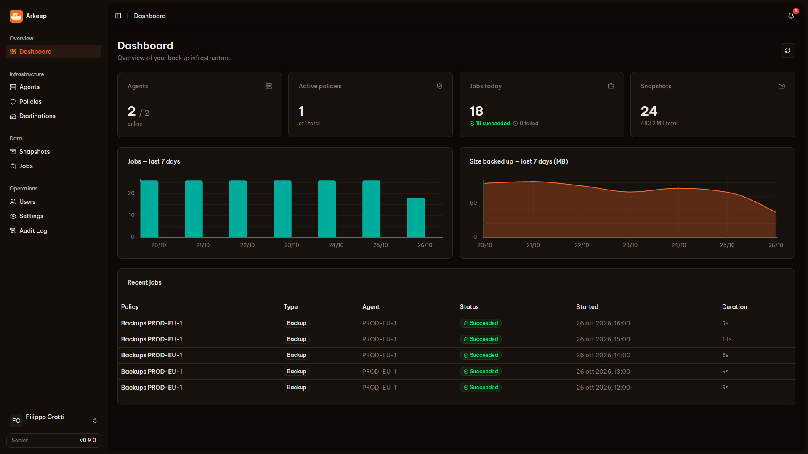

# Arkeep

> Your infra's Ark — back up everything, keep it yours.

[](https://github.com/arkeep-io/arkeep/releases/latest)
[](https://github.com/arkeep-io/arkeep/actions/workflows/ci.yml)
[](LICENSE)
[](https://hub.docker.com/r/arkeepio/arkeep-server)

Open-source, self-hosted control for [Restic](https://restic.net/) and [Rclone](https://rclone.org/):
one server, a lightweight agent on every machine, one dashboard.

**[Website](https://arkeep.io)** · **[Documentation](https://arkeep.io/docs/)** · **[Quickstart](https://arkeep.io/docs/quickstart/)** · **[Discussions](https://github.com/arkeep-io/arkeep/discussions)**



---

## Features

- **One policy, many destinations** — local disk, S3-compatible storage, SFTP, restic REST server and 40+ Rclone backends, for a real 3-2-1 setup
- **Docker-aware** — volumes are discovered on their own; databases stream straight into restic with `pg_dump`, `mysqldump` and friends
- **Retention and integrity checks** — per destination, on their own schedule
- **Browse and restore** — open any snapshot, download a file or a folder, restore a selection in place or elsewhere
- **Know when it fails** — email, webhooks (Slack, Discord, n8n…) and Healthchecks.io pings
- **Your login, your rules** — local accounts with TOTP 2FA, or single sign-on with any OIDC provider
- **No lock-in** — repositories stay plain restic, readable without Arkeep

More on the [website](https://arkeep.io/#features).

## How it works

The **server** hosts the web GUI and the REST API (port 8080) and schedules every job. An **agent** runs on
each machine you back up: it dials out to the server over gRPC (port 9090), enrolls on first start and
switches to mTLS on its own. Agents never listen on a port, so they work behind NAT and firewalls. State lives
in SQLite by default, or PostgreSQL.

Details in [Architecture](https://arkeep.io/docs/concepts/architecture/).

## Quickstart

You need Docker with Docker Compose. Images are on [Docker Hub](https://hub.docker.com/u/arkeepio) and
[GitHub Packages](https://github.com/orgs/arkeep-io/packages?repo_name=arkeep).

**1. Start the server** (GUI included):

```bash
mkdir arkeep && cd arkeep
curl -O https://raw.githubusercontent.com/arkeep-io/arkeep/main/deploy/docker/docker-compose.yml
curl -o .env https://raw.githubusercontent.com/arkeep-io/arkeep/main/deploy/docker/.env.example
sed -i "s|^ARKEEP_SECRET_KEY=.*|ARKEEP_SECRET_KEY=$(openssl rand -hex 32)|" .env
sed -i "s|^ARKEEP_AGENT_SECRET=.*|ARKEEP_AGENT_SECRET=$(openssl rand -hex 24)|" .env
docker compose up -d
```

Open `http://localhost:8080` and create the admin account. The setup page stays open for 15 minutes after
the server starts. Keep `.env` safe: `ARKEEP_SECRET_KEY` encrypts every credential Arkeep stores.

**2. Add an agent** on each machine you want to back up:

```bash
mkdir arkeep-agent && cd arkeep-agent
curl -O https://raw.githubusercontent.com/arkeep-io/arkeep/main/deploy/docker/docker-compose.agent.yml
cat > .env <<'EOF'
ARKEEP_SERVER_ADDR=your-server:9090
ARKEEP_AGENT_SECRET=same-value-as-on-the-server
EOF
docker compose -f docker-compose.agent.yml up -d
```

The agent shows up under **Agents** within a few seconds. Then add a destination, create a policy and run it.

Server behind a reverse proxy, standalone binaries, systemd, Kubernetes or a one-machine trial: see
[Installation](https://arkeep.io/docs/installation/docker-compose/) and the
[Quickstart guide](https://arkeep.io/docs/quickstart/).

## Documentation

Everything else lives at **[arkeep.io/docs](https://arkeep.io/docs/)**:

| | |
|---|---|
| **Install** | [Docker Compose](https://arkeep.io/docs/installation/docker-compose/) · [Binary](https://arkeep.io/docs/installation/binary/) · [Kubernetes (Helm)](https://arkeep.io/docs/installation/kubernetes/) · [Agent via systemd](https://arkeep.io/docs/installation/agent-systemd/) · [Reverse proxy and TLS](https://arkeep.io/docs/installation/reverse-proxy-tls/) |
| **Operate** | [Upgrading](https://arkeep.io/docs/installation/upgrading/) · [Backing up Arkeep itself](https://arkeep.io/docs/installation/backing-up-arkeep/) · [Health and metrics](https://arkeep.io/docs/reference/health-and-metrics/) |
| **Use** | [Destinations](https://arkeep.io/docs/guides/destinations/) · [Policies](https://arkeep.io/docs/guides/policies/) · [Databases](https://arkeep.io/docs/guides/databases/) · [Docker volumes](https://arkeep.io/docs/guides/docker-volumes/) · [Snapshots and restore](https://arkeep.io/docs/guides/snapshots-and-restore/) · [Notifications](https://arkeep.io/docs/guides/notifications/) |
| **Reference** | [Server configuration](https://arkeep.io/docs/reference/server-config/) · [Agent configuration](https://arkeep.io/docs/reference/agent-config/) · [Webhook events](https://arkeep.io/docs/reference/webhook-events/) · [FAQ](https://arkeep.io/docs/reference/faq/) |

## Roadmap

- **v1.0 — Production-ready core:** restore and restore test, Helm chart, documentation site, broader test coverage
- **v1.x — Inventory:** hosts, containers and VMs in one view, with a backup coverage map
- **v2.0 — Update orchestration:** Docker, OS and Proxmox updates gated by a recent verified backup, with rollback
- **v2.x — Intelligence:** CVE correlation, AI reports, bandwidth throttling, BYOK keys

Full list on the [website](https://arkeep.io/#roadmap).

## Telemetry

Arkeep sends an anonymous daily ping (random instance ID, version, OS, number of agents and policies). No
personal data, backup contents, credentials or hostnames. Turn it off with `ARKEEP_TELEMETRY=false`; see
[Telemetry](https://arkeep.io/docs/reference/telemetry/).

## Contributing

Contributions are welcome. Please read [CONTRIBUTING.md](CONTRIBUTING.md) and the
[development setup](https://arkeep.io/docs/contributing/development/) first. Security issues: see
[SECURITY.md](SECURITY.md).

## Support Arkeep

Hey 👋 I’m Filippo, the independent maintainer of Arkeep.

Arkeep is built around a simple idea: before touching production, you should know you have a backup you can actually recover from.

If Arkeep saves you time, helps your workflow, or gives you more confidence managing your infrastructure, you can support the work behind it through GitHub Sponsors.

Sponsoring is a bit like buying me a coffee for open source: it helps me spend more time on bug fixes, documentation, releases, restore testing, and the next pieces of the roadmap, from inventory to safer update orchestration.

[Become a sponsor](https://github.com/sponsors/arkeep-io)

## Sponsors

Thank you to everyone who has sponsored Arkeep, past and present. Your support keeps the project independent and moving forward.

<!-- sponsors --><a href="https://github.com/123-soleil"></a><!-- sponsors -->

## License

Arkeep is licensed under the [Apache License 2.0](LICENSE).

Copyright 2026 Filippo Crotti / Arkeep Contributors
